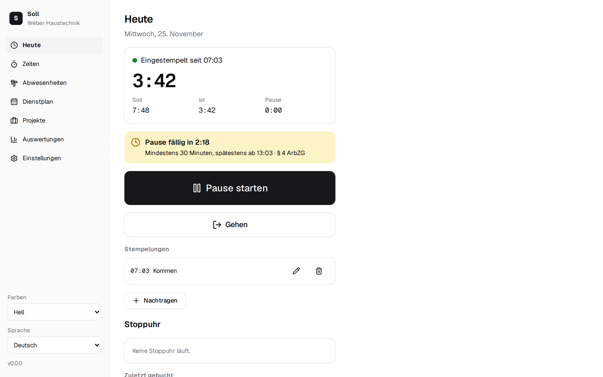

# Soll

**Arbeitszeit erfassen, wie es das Gesetz verlangt – auf deinem eigenen Server.**

Soll ist eine selbst gehostete Zeiterfassung mit Dienstplan für kleine Betriebe: Stempeln im
Browser, am Handy und am Tablet, Prüfung nach Arbeitszeitgesetz mit Paragraph, Urlaub und
Krankmeldung, Monatsabschluss mit Prüfwert und Lohndaten für DATEV. Open Source, ohne Kosten pro
Kopf.



## Was Soll besonders macht

- **Prüfung nach Paragraph:** Höchstarbeitszeit (§ 3 ArbZG), Pausen (§ 4 ArbZG), Ruhezeit
  (§ 5 ArbZG), Nacht-, Sonn- und Feiertagsarbeit, Mindestlohn, Minijob-Grenze, Jugendschutz und
  Mutterschutz – jeder Befund nennt die konkrete Norm im [Regelwerk](regeln.md).
- **Unveränderlicher Monatsabschluss:** Jede Schreiboperation hängt an die
  [Audit-Kette](audit-kette.md) an; Beschäftigte bestätigen ihren Monat und erhalten auf dem
  Stundenzettel einen Prüfwert, der nachträgliche Änderungen aufdeckt.
- **Modulare Einrichtung:** Arbeitszeit, [Dienstplan](dienstplan.md), [Projektzeit](projektzeit.md)
  und [Terminal](terminal.md) lassen sich je Betrieb einzeln ein- und ausschalten.
- **Reibungsloser Umzug:** Zeiten, Abwesenheiten, Kunden, Aufträge, Tätigkeiten, Schichten und
  Salden zum Stichtag aus anderen Tools oder Excel/CSV übernehmen ([Umzug](umzug.md)).
- **Selbst gehostet & ohne Kosten pro Kopf:** Läuft als einzelner Container mit SQLite auf deinem
  eigenen Server oder NAS ([Installation](installation.md)).

## Funktionen im Überblick

| Bereich | Was Soll abdeckt | Seite |
| --- | --- | --- |
| Stempeln & Zeiten | Kommen, Pause, Gehen im Web, als PWA offline und mit Korrekturgrund | [Stempeln](stempeln.md) |
| Terminal am Eingang | Android-Tablet mit PIN, QR-Code oder NFC-Karte, auch ohne Netz | [Terminal](terminal.md) |
| Abwesenheiten & Konten | Urlaub mit Verfallshinweis, Krankmeldung/eAU, Kinderkrankentage, Überstundenkonto | [Abwesenheiten](abwesenheiten.md) |
| Dienstplan | Schichtvorlagen, Bedarf je Rolle, Arbeitszeitprüfung beim Planen, Schichttausch, iCal-Feed | [Dienstplan](dienstplan.md) |
| Projektzeit | Kunden, Aufträge mit Budgetwarnung, Stoppuhr, Stundennachweis mit Unterschrift | [Projektzeit](projektzeit.md) |
| Monatsabschluss & Export | Bestätigung, Abschluss, Stundenzettel-PDF, Prüfexport und GoBD-Verfahrensdokumentation | [Monatsabschluss](monatsabschluss.md) |
| Lohn & Buchhaltung | DATEV-Lohnexport (LODAS / Lohn und Gehalt) mit Zuschlägen nach § 3b EStG | [DATEV-Lohnexport](datev.md) |
| Datenschutz & Betrieb | Infoblatt für Beschäftigte, Vorlage Betriebsvereinbarung, Löschkonzept | [Löschkonzept](loeschkonzept.md) |
| Schnittstellen | Versionierte REST-API und schreibgeschützter MCP-Server für KI-Assistenten | [REST-API und MCP-Server](api.md) |

## Schnellstart

```sh
mkdir soll && cd soll
curl -fsSLO https://raw.githubusercontent.com/Speicherstadt/soll/main/deploy/compose.yaml
curl -fsSL -o soll.env https://raw.githubusercontent.com/Speicherstadt/soll/main/deploy/soll.env.example
# in soll.env: SOLL_SECRET_KEY (openssl rand -base64 32) und SOLL_URL eintragen
docker compose up -d
```

Alle Details zu Podman, Backup und Reverse Proxy stehen in der [Installation](installation.md); zum
unverbindlichen Ausprobieren gibt es [Demo-Daten](demo.md).
